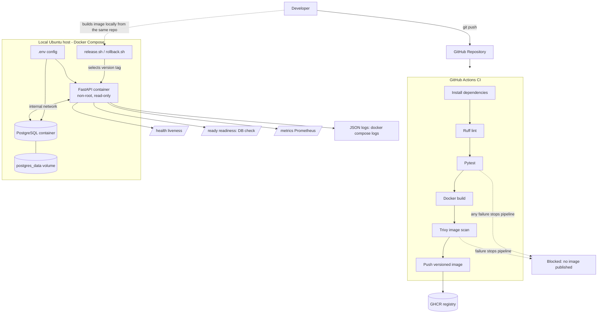

# SecureRelease API — DevOps Project

<p align="center">

  **A Containerized API with Automated CI/CD, Secure Deployment, Observability and Rollback**

  
  
  
  
  
  

</p>

## Table of Contents

1. [Project Overview](#1-project-overview)
2. [Architecture](#2-architecture)
3. [Technology Stack](#3-technology-stack)
4. [Project Structure](#4-project-structure)
5. [Prerequisites](#5-prerequisites)
6. [Clone the Repository](#6-clone-the-repository)
7. [Environment Configuration](#7-environment-configuration)
8. [Build and Deploy with Docker Compose](#8-build-and-deploy-with-docker-compose)
9. [API Endpoints](#9-api-endpoints)
10. [CI/CD Pipeline](#10-cicd-pipeline)
11. [Automated Testing](#11-automated-testing)
12. [Versioned Release and Rollback](#12-versioned-release-and-rollback)
13. [Security Implementation](#13-security-implementation)
14. [Observability and Failure Investigation](#14-observability-and-failure-investigation)
15. [Persistent Storage](#15-persistent-storage)
16. [Cost-Aware Cloud Hosting](#16-cost-aware-cloud-hosting)
17. [Documentation and Evidence](#17-documentation-and-evidence)
18. [Assessment Scope and Limitations](#18-assessment-scope-and-limitations)
19. [AI Assistance Disclosure](#19-ai-assistance-disclosure)
20. [Conclusion](#20-conclusion)
21. [Evidence of Execution](#21-evidence-of-execution)
22. [Rubric-to-Evidence Map](#22-rubric-to-evidence-map)

## 1. Project Overview

Apex Operations API is a practical Junior DevOps Engineer assessment project developed for Apex AI Arabia.

The project demonstrates an end-to-end DevOps workflow for a small API, covering:

- Application containerization using Docker.
- Local deployment using Docker Compose.
- PostgreSQL database integration and persistent storage.
- Automated CI using GitHub Actions.
- Python linting and automated testing.
- Docker image vulnerability scanning using Trivy.
- Versioned release and executable rollback scripts.
- Non-root container execution and security hardening.
- Structured application logging and Prometheus metrics.
- Health checks, readiness checks and failure investigation.

**Project objective:** Build a reproducible and reviewable path from code commit to application release, with practical operational evidence.

## 2. Architecture



### Architecture explanation

1. Developers push application changes to GitHub.
2. GitHub Actions installs dependencies and performs linting and automated tests.
3. The workflow builds the Docker image.
4. Trivy scans the image for vulnerabilities.
5. A successful workflow publishes the versioned image to GitHub Container Registry.
6. Docker Compose runs the API and PostgreSQL in the local Ubuntu assessment environment.
7. Health checks, readiness checks, metrics and logs support operational monitoring.
8. Release and rollback scripts manage local versioned Docker images.

**Deployment scope:** The assessment implementation uses local Docker Compose. The CI workflow publishes images; it does not automatically deploy to a public production environment.

## 3. Technology Stack

| Category | Technology |
|---|---|
| Programming language | Python |
| API framework | FastAPI |
| Database | PostgreSQL |
| Containerization | Docker |
| Container orchestration | Docker Compose |
| CI/CD | GitHub Actions |
| Code quality | Ruff |
| Automated testing | Pytest |
| Image security | Trivy |
| Container registry | GitHub Container Registry |
| Metrics | Prometheus Client |
| Operating system | Ubuntu Linux |
| Scripting | Bash |
| Version control | Git and GitHub |

## 4. Project Structure

```text
apex-ops-api/
│
├── .github/
│   └── workflows/
│       └── ci-cd.yml
│
├── app/
│   ├── __init__.py
│   └── main.py
│
├── tests/
│   ├── __init__.py
│   └── test_api.py
│
├── scripts/
│   ├── release.sh
│   └── rollback.sh
│
├── docs/
│   ├── RUNBOOK.md
│   ├── DECISION-MEMO.md
│   └── AI-USE-DISCLOSURE.md
│
├── evidence/
│   ├── screenshots/
│   ├── application-logs.txt
│   ├── container-security.txt
│   ├── docker-deployment.txt
│   ├── health-check.txt
│   ├── prometheus-metrics.txt
│   ├── readiness-check.txt
│   ├── release-version.txt
│   ├── rollback-state.txt
│   └── test-results.txt
│
├── .dockerignore
├── .env.example
├── .gitignore
├── Dockerfile
├── docker-compose.yml
├── requirements.txt
└── README.md
```

Local `.env` and `.release-state` files are intentionally excluded from Git.

## 5. Prerequisites

Install the following on Ubuntu:

- Docker Engine
- Docker Compose plugin
- Git
- Python 3.12 or compatible local test environment

Verify the installations:

```bash
docker --version
docker compose version
git --version
python3 --version
```

## 6. Clone the Repository

```bash
git clone https://github.com/Mahendra0456/apex-ops-api.git
cd apex-ops-api
```

## 7. Environment Configuration

Create the local environment file:

```bash
cp .env.example .env
```

Edit `.env` and configure a unique local database password.

The following values must match:

- `POSTGRES_PASSWORD`
- `DB_PASSWORD`

Example configuration:

```env
POSTGRES_DB=apex
POSTGRES_USER=apex
POSTGRES_PASSWORD=your-local-password

DB_HOST=db
DB_NAME=apex
DB_USER=apex
DB_PASSWORD=your-local-password

APP_VERSION=local
```

**Security note:** These are example configuration values, not production credentials. Never commit `.env` or real passwords to GitHub.

## 8. Build and Deploy with Docker Compose

Build the application image and start both services:

```bash
docker compose up -d --build
```

Check the running containers:

```bash
docker compose ps
```

View application logs:

```bash
docker compose logs --tail=50 api
```

View database logs:

```bash
docker compose logs --tail=50 db
```

The API is exposed on:

```text
http://127.0.0.1:8000
```

PostgreSQL is accessible through the internal Docker network and is not published on a host port.

## 9. API Endpoints

| Method | Endpoint | Description |
|---|---|---|
| GET | `/health` | Application health and version |
| GET | `/ready` | Database readiness |
| GET | `/metrics` | Prometheus metrics |
| POST | `/tasks` | Create a task |
| GET | `/tasks` | Retrieve tasks |

### Health check

```bash
curl -i http://127.0.0.1:8000/health
```

Expected response:

```json
{
  "status": "ok",
  "version": "v1.0.0"
}
```

### Readiness check

```bash
curl -i http://127.0.0.1:8000/ready
```

Expected response when PostgreSQL is available:

```json
{
  "status": "ready"
}
```

### Create a task

```bash
curl -X POST http://127.0.0.1:8000/tasks \
  -H "Content-Type: application/json" \
  -d '{"name":"Assessment demo task"}'
```

### Retrieve tasks

```bash
curl http://127.0.0.1:8000/tasks
```

### Prometheus metrics

```bash
curl http://127.0.0.1:8000/metrics
```

The metrics endpoint exposes HTTP request counters by path and response status.

## 10. CI/CD Pipeline

The GitHub Actions workflow is located at:

```text
.github/workflows/ci-cd.yml
```

### Pipeline stages

| Stage | Description |
|---|---|
| Dependency installation | Install Python dependencies |
| Lint | Run Ruff |
| Automated tests | Run Pytest |
| Docker build | Build application image |
| Image scanning | Scan using Trivy |
| Image publishing | Push successful image to GHCR |

The workflow is configured to block subsequent image publishing when required validation or security checks fail.

Images are versioned using the Git commit SHA and a `latest` tag for the main branch.

A successful run is shown in [Evidence 5](#evidence-5--github-actions-pipeline-success).

## 11. Automated Testing

Run linting:

```bash
ruff check .
```

Run automated tests:

```bash
pytest -v
```

The final automated test suite contains six checks:

1. Application health response.
2. Application version information.
3. Prometheus metrics endpoint.
4. Database failure handling.
5. Invalid task input validation.
6. Unknown route handling.

An intentional failing test was executed separately to demonstrate failure detection. It was subsequently removed, leaving the final test suite passing.

Recorded final test result:

```text
6 passed
```

The recorded test run also reports one non-blocking Starlette deprecation warning. See [Evidence 1](#evidence-1--automated-test-results).

## 12. Versioned Release and Rollback

The project includes executable Bash scripts for versioned release and rollback.

### Release

Example:

```bash
./scripts/release.sh v1.0.0
```

A subsequent release:

```bash
./scripts/release.sh v1.0.1
```

Verify the running version:

```bash
curl http://127.0.0.1:8000/health
```

### Rollback

```bash
./scripts/rollback.sh
```

Verify the restored version:

```bash
curl http://127.0.0.1:8000/health
```

The scripts use locally available versioned Docker images and `.release-state` to track release history.

The demonstrated rollback restored the application from v1.0.1 to v1.0.0. See [Evidence 4](#evidence-4--release-and-rollback-state).

## 13. Security Implementation

The application container includes the following security controls:

- Dedicated non-root user (`apex`, UID 10001).
- Read-only container root filesystem.
- All Linux capabilities dropped.
- `no-new-privileges` enabled.
- PostgreSQL restricted to the internal Docker network.
- API host binding restricted to localhost.
- Environment configuration separated from source code.
- `.env` excluded through `.gitignore`.
- Restricted GitHub Actions workflow permissions.
- Trivy container image vulnerability scanning.

The observed container security configuration is recorded in:

```text
evidence/container-security.txt
```

See [Evidence 6](#evidence-6--container-security-configuration).

## 14. Observability and Failure Investigation

### Structured logging

Application logs use JSON formatting and include:

- Timestamp
- Log severity
- Request information
- HTTP status code
- Application version

Inspect logs:

```bash
docker compose logs --tail=100 api
```

### Health and readiness

The `/health` endpoint checks application availability.

The `/ready` endpoint verifies database connectivity and returns HTTP 503 when the database is unavailable.

### Metrics

The `/metrics` endpoint exposes Prometheus request counters.

### Demonstrated database failure

The database was stopped to simulate an outage.

Observed behavior:

- Database-dependent readiness check returned HTTP 503.
- The failure was investigated through service status and application logs.
- PostgreSQL was restarted.
- Database readiness recovered to HTTP 200.

Full terminal capture: [Evidence 7](#evidence-7--failure-investigation-database-outage).

### Suggested future alerts

| Alert | Condition |
|---|---|
| API availability | `/health` failing |
| Database readiness | `/ready` returning 503 |
| HTTP 5xx rate | Sustained elevated 5xx responses |
| Container restarts | Repeated restarts |
| Resource utilization | High CPU or memory |

## 15. Persistent Storage

Docker Compose uses a named PostgreSQL volume:

```text
postgres_data
```

This keeps database data persistent across ordinary container recreation.

Stop services:

```bash
docker compose down
```

To remove the database volume and its stored data:

```bash
docker compose down -v
```

**Warning:** The second command permanently deletes the local database data.

## 16. Cost-Aware Cloud Hosting

The assessment was implemented using local Docker Compose and did not require paid cloud resources.

For a future cloud deployment, possible improvements include:

- Selecting an appropriately sized compute or container platform.
- Monitoring CPU, memory and network usage.
- Using managed database services where justified.
- Configuring budget alerts and spending limits.
- Applying least-privilege IAM policies.
- Avoiding unnecessary always-on infrastructure.

These are future deployment considerations, not claims of an existing paid cloud deployment.

## 17. Documentation and Evidence

Additional project documentation:

| File | Purpose |
|---|---|
| `docs/RUNBOOK.md` | Deployment, rollback and troubleshooting |
| `docs/DECISION-MEMO.md` | Architecture decisions and trade-offs |
| `docs/AI-USE-DISCLOSURE.md` | AI assistance disclosure |

Execution evidence is maintained in `evidence/` (raw text outputs) and `evidence/screenshots/` (captures shown in section 21).

It includes test results, container status, health checks, readiness checks, logs, metrics, release information and security configuration.

## 18. Assessment Scope and Limitations

This implementation is a practical Junior DevOps Engineer assessment project.

It demonstrates local deployment, automated validation, image scanning, container security, observability, failure investigation, and executable rollback.

It is not presented as a production-ready system.

Additional production requirements could include TLS, authenticated API access, managed secrets, database backups, centralized monitoring, alert delivery, and a formally tested disaster recovery process.

No Apex production systems, real customer data, production credentials, or paid cloud resources were used.

## 19. AI Assistance Disclosure

AI assistance was used for implementation guidance, troubleshooting, test development, documentation preparation, and technical review.

The specific uses and candidate validation activities are documented in:

```text
docs/AI-USE-DISCLOSURE.md
```

## 20. Conclusion

Apex Operations API demonstrates a practical DevOps delivery workflow from source control and automated CI validation through containerized deployment, observability, versioned releases, and rollback.

The project emphasizes reproducibility, security hygiene, failure handling, and clear operational documentation.

- **Project:** Apex Operations API
- **Assessment:** Apex AI Arabia — Junior DevOps Engineer
- **Repository:** https://github.com/Mahendra0456/apex-ops-api

---

## 21. Evidence of Execution

All evidence was captured from the Ubuntu assessment host on 30 Oct 2026. Raw outputs are in `evidence/`; screenshots are in `evidence/screenshots/`.

### Evidence 1 — Automated test results

Command: `pytest -v 2>&1 | tee evidence/test-results.txt`


| Test | Result |
|---|---|
| `test_health` | PASSED |
| `test_health_has_version` | PASSED |
| `test_metrics` | PASSED |
| `test_create_task_database_unavailable` | PASSED |
| `test_invalid_task` | PASSED |
| `test_root_not_found` | PASSED |

Result: **6 passed, 1 warning in 0.25s** (pytest 8.3.3; the warning is a non-blocking Starlette `httpx` deprecation notice). Run in a local virtual environment on the Ubuntu host.

### Evidence 2 — Docker Compose deployment

Command: `docker compose ps | tee evidence/docker-deployment.txt`


| Service | Image | Status | Ports |
|---|---|---|---|
| `api` | `apex-ops-api:v1.0.0` | Up (healthy) | `127.0.0.1:8000->8000/tcp` |
| `db` | `postgres:16-alpine` | Up (healthy) | `5432/tcp` (internal only, not published) |

### Evidence 3 — Health and readiness checks

Commands: `curl -fsS http://127.0.0.1:8000/health | tee evidence/health-check.txt` and the same for `/ready` (`evidence/readiness-check.txt`).


```json
{"status":"ok","version":"v1.0.0"}
{"status":"ready"}
```

### Evidence 4 — Release and rollback state

Commands: `curl -fsS http://127.0.0.1:8000/health | tee evidence/release-version.txt` and `cat .release-state | tee evidence/rollback-state.txt`


```text
{"status":"ok","version":"v1.0.0"}
v1.0.0 v1.0.1      # .release-state: releases tracked v1.0.0 and v1.0.1
```

The running application reports `v1.0.0` after the rollback from `v1.0.1`.

### Evidence 5 — GitHub Actions pipeline success

Workflow job **Lint, Test, Build and Scan**: succeeded in 1m 11s.


| Step | Result | Duration |
|---|---|---|
| Set up job / Checkout source code / Setup Python | Passed | 3s / 1s / 0s |
| Install dependencies | Passed | 8s |
| Ruff lint | Passed | 0s |
| Run tests | Passed | 1s |
| Build Docker image | Passed | 16s |
| Trivy vulnerability scan | Passed | 18s |
| Login to GitHub Container Registry | Passed | 1s |
| Push image to GHCR | Passed | 14s |
| Post steps / Complete job | Passed | 0–5s |

Run URL: `https://github.com/Mahendra0456/apex-ops-api/actions/runs/41069443738`

### Evidence 6 — Container security configuration

Command: `docker inspect apex-ops-api-api-1 --format '...' | tee evidence/container-security.txt`


```text
User=apex ReadonlyRootfs=true CapDrop=["ALL"] SecurityOpt=["no-new-privileges:true"]
```

Metrics and logs were also captured: `evidence/prometheus-metrics.txt` and `evidence/application-logs.txt`.

### Evidence 7 — Failure investigation (database outage)

Sequence: stop `db` → check `/ready` → start `db` → confirm recovery.


| Step | Command | Observed result |
|---|---|---|
| 1. Simulate failure | `docker compose stop db` | `apex-ops-api-db-1 Stopped` |
| 2. Detect | `curl -i http://127.0.0.1:8000/ready` | `HTTP/1.1 503 Service Unavailable`, body `{"detail":"db unavailable"}` (16:06:25 GMT) |
| 3. Recover | `docker compose start db` | `apex-ops-api-db-1 Started` |
| 4. Verify status | `docker compose ps` | `api` Up 2 hours (healthy); `db` Up 12 seconds (healthy) |
| 5. Confirm | `curl -i http://127.0.0.1:8000/ready` | `HTTP/1.1 200 OK`, body `{"status":"ready"}` (16:07:35 GMT) |

**Analysis:** The API process stayed healthy (liveness unaffected) while readiness correctly reported the dependency outage, so traffic would be withheld without restarting the application. Recovery needed only the database restart; no application redeploy was required.

## 22. Rubric-to-Evidence Map

| Assessment criterion | Where demonstrated |
|---|---|
| Reproducible deployment and containers | Sections 5–8, Evidence 2, 3 |
| CI/CD quality and release safety | Sections 10, 12, Evidence 4, 5 |
| Security and configuration hygiene | Section 13, Evidence 6 |
| Monitoring, troubleshooting and rollback | Sections 12, 14, Evidence 4, 7 |
| Testing and documentation | Section 11, Evidence 1, `docs/` |
| Communication and ownership | `docs/DECISION-MEMO.md`, section 19 |
